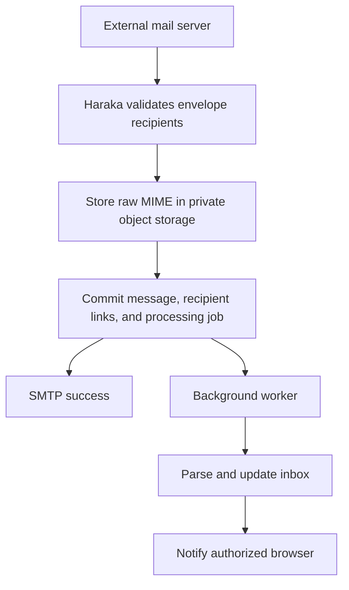

# Temporary email SaaS architecture

Haraka will receive mail. The application will create private temporary inboxes, store received messages durably, and show them to their owners through a web interface.

**Acceptance rule:** after address creation returns successfully, every Haraka receiver must recognize the address. After SMTP delivery is acknowledged, the raw message and its processing job must survive a receiver or worker restart.

## Planned stack

| Component | Choice | Responsibility |
| --- | --- | --- |
| Frontend | Next.js, React, TypeScript | Address creation, inbox selection, reader, expiry countdown |
| Backend | Node.js, Fastify, TypeScript | Inbox creation, authentication, quotas, message access |
| Mail receiver | Haraka with recipient and queue plugins | SMTP reception and recipient validation |
| Database | PostgreSQL | Sessions, addresses, expiry, message metadata, durable processing jobs |
| Object storage | Private Cloudflare R2 through its S3-compatible API | Raw MIME messages and attachments |
| Workers | Separate Node.js processes | MIME parsing, retries, expiry and object cleanup |
| Coordination | Redis when multiple API instances need it | Distributed rate limits and notification fan-out |
| Browser updates | Server-Sent Events with refetch on reconnect | Inbox notifications; database remains authoritative |
| Deployment | Docker on Linux servers | Independent scaling of frontend, API, SMTP, and workers |

Keep these services in one repository and run them as separate processes. A disk-backed object store is permitted for development; multiple mail servers must share durable object storage in production.

## Domain and mail routing

For temporary addresses such as `random123@mail.example.com`:

```text
mail.example.com       MX 10 mx1.example.com
mx1.example.com        A     <mail-server-public-IP>
```

The receiver needs a public IP, inbound TCP port 25, a configured hostname, and STARTTLS. Website and API traffic use HTTPS. SMTP goes directly to the receiver; ordinary HTTP proxying does not carry it.

All temporary addresses share the domain's MX configuration. New inboxes need database inserts, never per-address DNS records or operating-system mailbox accounts. A second Haraka receiver can have another MX record while sharing the same inbox database and object store.

## Address creation

1. Browser sends `POST /api/inboxes` using an authenticated anonymous session or signed-in account.
2. Backend checks creation rate, maximum active inboxes, and retention limits.
3. Generate a cryptographically random local part. Enforce address uniqueness in PostgreSQL.
4. Insert the inbox with its owner, domain, creation time, and expiration.
5. Commit, then return the address and expiry.

Haraka reads the same primary database for recipient validation. Do not validate newly created addresses against a lagging replica. Avoid negative recipient caching that could hide a new address.

Browser access uses Secure, HttpOnly cookies in production. Developer credentials are separately scoped. An email address or inbox ID alone never authorizes reading messages. Do not put the server API key in client JavaScript.

## Receiving and acknowledging mail



Recipient checks validate the configured domain, existence, active status, expiration, and capacity. Unknown or expired recipients receive permanent SMTP failures. Temporary infrastructure failures receive temporary SMTP errors, allowing sender retries. The SMTP envelope recipient determines routing, including BCC; the visible `To:` header does not.

Store raw MIME first. In one PostgreSQL transaction, record its object key, recipients, and processing state. Return SMTP success only when the object write and database commit have succeeded. Never acknowledge based only on memory or a notification queue.

Object storage and PostgreSQL do not share a transaction. Track uploads durably and reconcile abandoned objects after a grace period. A failed database commit must not leave stored objects permanently unreachable. Retry ambiguous SMTP deliveries conservatively; sender retries can still produce separate messages, so do not promise exactly-once SMTP delivery.

Raw mail and attachments belong in object storage. PostgreSQL holds references, metadata, and processing state, keeping large files out of database backups and replication.

## Processing and live updates

Workers claim jobs with short PostgreSQL transactions and `FOR UPDATE SKIP LOCKED`, then use expiring leases. Parse outside the claim transaction. A crashed worker's lease expires so another worker can retry. Lease ownership must be checked before final updates, preventing a stale worker from overwriting a newer attempt.

Extract subject, sender, text, and attachment metadata. Prepare sanitized HTML before enabling HTML display. Attachments require validation and a quarantine/scanning policy before direct download is offered. Keep raw MIME downloadable only after authorization, with attachment disposition.

Use bounded retries and exponential backoff. Failed jobs remain inspectable; they are never silently discarded. Unique message/delivery constraints make internal retries idempotent.

Redis notification fan-out is optional initially. Events are hints: browsers always fetch durable messages through the API and refetch after reconnecting. Losing a notification must not lose an email.

## Frontend behavior

- Create and copy a temporary address.
- Switch between owned inboxes.
- Show expiration and active/expired status.
- Update automatically as messages arrive.
- Read text safely; add sandboxed sanitized HTML later.
- Download authorized raw MIME and permitted attachments.
- Delete an inbox.

The initial website must use actual API data. Do not seed fake messages into a live inbox or claim external receiving is active until DNS and the mail server are configured.

## Privacy, retention, and limits

Proposed initial retention is one hour, configurable by plan. Enforce expiry on every recipient lookup and API access, independently of cleanup scheduling. Do not reassign expired addresses: delayed mail must never reach another owner. Keep retired-address uniqueness records or a non-reversible reservation after removing private inbox content.

Cleanup removes expired inboxes, recipient links, and unreferenced objects. An email with multiple recipients is retained while an active inbox still needs it. Cleanup is retriable across database/object-store failures. Raw objects have no public bucket access.

Define limits for active inboxes, creation rate, messages/bytes per inbox, message and attachment size, SMTP connections, and retention. Apply protection to both HTTP and SMTP; creating unlimited addresses is not the same as unlimited storage or bandwidth.

Email HTML must be sanitized and sandboxed, scripts blocked, and external images disabled by default. Plain-text display is the first implementation. Use CSRF protection for cookie-authorized writes. Tokens, message bodies, and storage credentials must not appear in logs.

## Scaling plan

| Pressure | Action |
| --- | --- |
| More website requests | Add stateless frontend/API instances behind HTTPS load balancing |
| More SMTP connections | Add Haraka receivers with shared primary DB and object storage |
| More pending parsing jobs | Add worker processes with independent leases |
| Database connection pressure | Add connection pooling and tune per-service pools |
| Heavy inbox reads | Index delivery lookups, paginate, selectively cache or use replicas |
| Growing retained files | Scale object storage and monitor cleanup lag |
| PostgreSQL job claim pressure | Add a dedicated broker through a transactional outbox |
| Availability needs | Multiple MX receivers, database failover, backups, recovery tests |

Start with Docker deployment on separate mail and application hosts. Prefer managed PostgreSQL with backups. Use shared object storage before scaling to multiple receivers. Kubernetes is not needed for the first release.

Measure actual throughput, average MIME size, concurrency, and retention. For illustration, 100 messages/second is 8.64 million/day; at 100 KB each that is approximately 864 GB/day before overhead. Address count alone is not a capacity benchmark.

Monitor SMTP acceptance/rejection rates, database and upload latency, queue age, worker failures, API latency, active inboxes, stored bytes, and expiry-cleanup lag. Alert before storage or job backlog exhaustion.

## Build and verification sequence

1. Complete local create-address → SMTP delivery → authenticated inbox API.
2. Add object storage, worker leases/retries, cleanup, and recovery tests.
3. Build Next.js interface and secure browser-session access.
4. Configure real domain, public mail server, TLS, and HTTPS.
5. Verify external delivery to a newly created inbox.
6. Test bursts, simultaneous creations, MIME/attachments, receiver restart, worker crashes, storage failures, and expiry races.
7. Add accounts, plans, billing, and administrative operations.

Local integration tests must check immediate recipient acceptance, unserved/expired address rejection, mixed recipients, BCC routing, body integrity, privacy between sessions, object storage failures, worker recovery, retention, and persisted messages across process restart.

Do not claim a production launch or external delivery verification based only on local SMTP tests. Real DNS, inbound port 25, certificates, cloud credentials, load benchmarks, and failover remain deployment requirements.

## Reference documentation

- [Haraka plugin hooks](https://haraka.github.io/core/Plugins/)
- [SMTP acceptance and retry responsibilities](https://www.rfc-editor.org/rfc/rfc5321.html)
- [PostgreSQL SELECT and SKIP LOCKED](https://www.postgresql.org/docs/current/sql-select.html)
- [R2 S3 compatibility](https://developers.cloudflare.com/r2/api/s3/api/)
- [Next.js deployment](https://nextjs.org/docs/app/getting-started/deploying)

## Implementation baseline

The initial scaffold uses Node.js CommonJS, a basic HTTP API, PostgreSQL raw-message storage, and Haraka. Seven focused tests passed at the time this outline was saved; full SMTP integration was not yet verified. Work continues toward the stack and acceptance criteria above. Consult `README.md` for current runnable behavior and remaining limitations.
